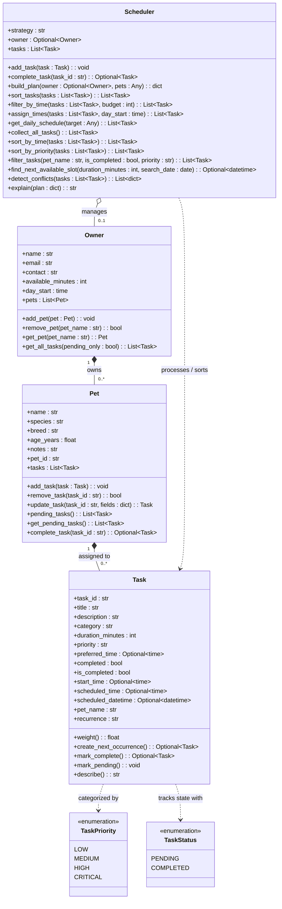

# PawPal+ Smart Pet Care Management System

> **A smart, object-oriented pet care coordination platform and algorithmic scheduling engine designed for busy multi-pet households.**

PawPal+ combines a rigorous Object-Oriented Programming (OOP) domain model with intelligent scheduling algorithms and an interactive Streamlit dashboard. It eliminates care bottlenecks, catches scheduling conflicts across multiple pets, tracks daily time budgets, and automates recurring wellness routines (feeding, walks, medications, and vet visits).

### 🛠️ Technology Stack
- **Language**: Python 3.10+ / 3.14
- **Architecture**: Object-Oriented Domain Model (Python Dataclasses)
- **User Interface**: Streamlit (Modern Dashboard with Custom Design System & Glassmorphism Badges)
- **Testing & Verification**: Pytest 9.x (Comprehensive Unit & Boundary Test Suite)
- **Modeling & Diagramming**: Mermaid.js Class Architecture (`diagrams/uml_final.mmd`)

---

## 🏛️ Architecture & System Design

PawPal+ is architected around 4 decoupled primary domain classes and standard enumeration types:

1. **`Owner`**: Manages caregiver profile data, contact details, daily time budget constraints (`available_minutes`), operating day start time (`day_start`), and a composition collection of registered pets. Aggregates tasks across all household pets via `get_all_tasks()`.
2. **`Pet`**: Encapsulates animal profile metadata (name, species, breed, age, notes) and manages an internal collection of care tasks. Provides lifecycle methods `add_task()`, `remove_task()`, `pending_tasks()`, and `complete_task()`.
3. **`Task`**: Represents an atomic unit of pet care. Tracks title, description, category (`walk`, `feeding`, `medication`, `appointment`, `grooming`), duration in minutes, priority tier (`LOW`, `MEDIUM`, `HIGH`, `CRITICAL`), preferred/scheduled times, completion states (`completed`, `is_completed`), and recurrence rules (`NONE`, `DAILY`, `WEEKLY`).
4. **`Scheduler`**: The algorithmic logic engine. Operates across multi-pet household collections to execute multi-attribute chronological sorting, multi-criteria filtering, O(n log n) interval overlap conflict detection, recurring lifecycle progression, and next available continuous free slot recommendation.

### 📐 Mermaid Class Diagram (`diagrams/uml_final.mmd`)



---

## ⚡ Smarter Scheduling Features

PawPal+ includes an algorithmic scheduling engine implemented in `pawpal_system.py`:

- **Multi-Key Sorting (`Scheduler.sort_by_time`, `Scheduler.sort_by_priority`)**:
  - `Scheduler.sort_by_time`: Orders commitments chronologically by `scheduled_time`. If two tasks share the same start time, it intelligently tie-breaks using descending priority weights (`CRITICAL: 40` > `HIGH: 30` > `MEDIUM: 20` > `LOW: 10`).
  - `Scheduler.sort_by_priority`: Sorts tasks primarily by priority tier and weight, resolving equal priorities by earliest scheduled time to ensure critical healthcare routines take precedence.

- **Multi-Criteria Filtering (`Scheduler.filter_tasks`)**:
  - Aggregates tasks across all pets registered under the `Owner` and supports concurrent, combinable filtering by `pet_name` (case-insensitive substring match), completion state (`is_completed=True/False`), and priority tier (`"LOW"`, `"MEDIUM"`, `"HIGH"`, `"CRITICAL"`). Returns an empty list `[]` when no matches exist without throwing exceptions.

- **Automated Recurrence Engine (`Task.create_next_occurrence`, `Pet.complete_task`)**:
  - Automates repeating routines (`"DAILY"` or `"WEEKLY"`). When `Pet.complete_task(task_id)` or `Scheduler.complete_task(task_id)` is executed:
    - The original task is preserved in historical records as completed (`is_completed=True`) for full auditability.
    - If `recurrence == "DAILY"`, `create_next_occurrence()` instantiates a fresh pending task scheduled exactly 24 hours forward (`+ timedelta(days=1)`).
    - If `recurrence == "WEEKLY"`, the new occurrence is scheduled 7 days forward (`+ timedelta(days=7)`).
    - The new task is automatically appended to the pet's active task list.

- **Interval Overlap Conflict Detection (`Scheduler.detect_conflicts`)**:
  - Evaluates active (pending) time windows across all pets simultaneously using the mathematical interval intersection invariant:
    $$\text{start}_A < \text{end}_B \quad \text{and} \quad \text{start}_B < \text{end}_A$$
  - Runs in $O(n \log n)$ time by sorting commitments by start timestamp, enabling inner-loop early stopping as soon as `start_B >= end_A`.
  - Disregards completed tasks and handles back-to-back borders (`end_A == start_B`) without false positives.
  - Returns structured records with exact overlap duration in minutes and user-facing warning banners.

- **Next Open Slot Calculation (`Scheduler.find_next_available_slot`)**:
  - Scans an owner's daily calendar on any target date starting from `owner.day_start` (e.g., 08:00 AM) through operating hours (20:00).
  - Merges all existing pet commitments, calculates contiguous gaps, and returns the earliest open window capable of accommodating a continuous session of `duration_minutes`.

---

## 📸 Demo Walkthrough & CLI Output

### Streamlit UI Walkthrough
1. **Owner Dashboard & Summary Cards**: View registered caregiver profile information, day start hour, and daily time budget alongside live metric cards (Total Pets, Total Tasks, Pending Tasks, Completed Tasks).
2. **Multi-Pet Management**: Register new pets with species, breed, and age in the "Add / Manage" tab, then schedule one-time or repeating care tasks mapped to individual pets.
3. **Conflict Detection Banner**: Navigate to the "Daily Schedule & Dashboard" tab where `scheduler.detect_conflicts()` displays high-visibility warning cards for simultaneous overlapping commitments or a green success confirmation if clear.
4. **Interactive Filtering & Sorting Bar**: Filter the daily schedule dynamically by pet, status (Pending vs. Completed), or priority level, while toggling sorting between Chronological Time and Priority Tier.
5. **Interactive Completion & Recurrence Handling**: Toggle tasks between "Done" and "Undo". Marking a recurring task done immediately spawns the next occurrence for tomorrow/next week with a confirmation toast notification.
6. **Smart Slot Recommender Widget**: Expand the `🔍 Find Next Open Care Slot` tool, select a duration slider (e.g. 45 min) and date, and click "Scan Open Slot" to get an immediate metric card with start and end times.

### Terminal Demonstration Output (`python main.py`)

Below is the verified terminal output from running `python main.py`, showcasing the scenario with Owner Alex Carter, pets Luna and Mochi, out-of-order tasks, overlapping commitments, recurrence lifecycle, and the slot finder:

```text
============================================================================
🐾                     PAWPAL+ ALGORITHMIC ENGINE DEMO                      🐾
                Multi-Pet Scheduling, Conflicts & Slot Finder                 
============================================================================

👤 Owner: Alex Carter (alex@example.com)
🐾 Pets Registered: Luna (Golden Retriever) & Mochi (Siamese Cat)
📋 Total Tasks Loaded: 6 across all pets.

▶ STEP A: MULTI-ATTRIBUTE CHRONOLOGICAL SORTING
----------------------------------------------------------------------------
Unsorted Raw Input Order (Tasks as entered):
Scheduled   | Pet       | Priority   | Duration  | Recur    | Status     | Description
----------------------------------------------------------------------------------------
17:00       | Luna      | MEDIUM     | 30 min    | None     | PENDING    | Evening Park Walk
09:00       | Luna      | HIGH       | 45 min    | None     | PENDING    | Morning Walk
08:00       | Luna      | HIGH       | 15 min    | Daily    | PENDING    | Daily Breakfast
09:15       | Mochi     | HIGH       | 30 min    | None     | PENDING    | Vet Check & Vaccine
08:15       | Mochi     | CRITICAL   | 15 min    | Daily    | PENDING    | Insulin Injection
14:00       | Mochi     | LOW        | 20 min    | None     | PENDING    | Coat Brushing
----------------------------------------------------------------------------------------

Chronologically Ordered Schedule (via scheduler.sort_by_time()):
Scheduled   | Pet       | Priority   | Duration  | Recur    | Status     | Description
----------------------------------------------------------------------------------------
08:00       | Luna      | HIGH       | 15 min    | Daily    | PENDING    | Daily Breakfast
08:15       | Mochi     | CRITICAL   | 15 min    | Daily    | PENDING    | Insulin Injection
09:00       | Luna      | HIGH       | 45 min    | None     | PENDING    | Morning Walk
09:15       | Mochi     | HIGH       | 30 min    | None     | PENDING    | Vet Check & Vaccine
14:00       | Mochi     | LOW        | 20 min    | None     | PENDING    | Coat Brushing
17:00       | Luna      | MEDIUM     | 30 min    | None     | PENDING    | Evening Park Walk
----------------------------------------------------------------------------------------
✔ Successfully ordered all tasks from 08:00 AM to 17:00 PM with priority tie-breaking.

▶ STEP B: CROSS-PET CONFLICT DETECTION
----------------------------------------------------------------------------
🔍 Scanning all active commitments for overlapping time windows...
⚠ Found 1 Scheduling Conflict(s):
  [1] [CONFLICT] 'Morning Walk' (Luna, 09:00 - 09:45) overlaps with 'Vet Check & Vaccine' (Mochi, 09:15 - 09:45) by 30 mins.
      ↳ Overlap Window: 30 minutes simultaneous demand.

▶ STEP C: MULTI-CRITERIA FILTERING
----------------------------------------------------------------------------
🔍 Filter 1: Tasks with Priority == 'HIGH'
   • [HIGH] Morning Walk for Luna at 09:00
   • [HIGH] Daily Breakfast for Luna at 08:00
   • [HIGH] Vet Check & Vaccine for Mochi at 09:15

🔍 Filter 2: Tasks assigned specifically to 'Mochi'
   • [HIGH] Vet Check & Vaccine (30 min, scheduled 09:15)
   • [CRITICAL] Insulin Injection (15 min, scheduled 08:15)
   • [LOW] Coat Brushing (20 min, scheduled 14:00)

▶ STEP D: AUTOMATED RECURRING TASK LIFECYCLE
----------------------------------------------------------------------------
Completing recurring task: 'Daily Breakfast' for Luna (Recurrence: DAILY)...

Result of complete_task():
  1. Original Task ID: `7fb5c4bb` | Title: 'Daily Breakfast'
     Status: is_completed = True [PRESERVED IN HISTORY]
  2. Next Occurrence ID: `c4e1678a` | Title: 'Daily Breakfast'
     Status: is_completed = False [SPAWNED FOR NEXT CYCLE]
     New Scheduled Time: 2026-10-12 08:00
✔ Verified: Original task is preserved as DONE; new task spawned automatically for tomorrow!

▶ STEP E: STRETCH FEATURE — NEXT AVAILABLE SLOT FINDER
----------------------------------------------------------------------------
🔍 Searching for earliest continuous free window of 45 minutes on 2026-10-11...
✨ Found Available Window!
   Suggested Start: 2026-10-11 09:45
   Window Range:    09:45 ➔ 10:30 (45 min continuous opening)

============================================================================
🐾                              DEMO COMPLETE                               🐾
            All Phase 4 Algorithmic Features Successfully Verified            
============================================================================
```

---

## 🧪 Testing PawPal+

### Test Execution

Execute the full automated test suite using pytest with verbose output:

```bash
python -m pytest -v
```

### Coverage Summary

The test suite in [`tests/test_pawpal.py`](tests/test_pawpal.py) provides comprehensive unit, integration, and edge-case coverage:
- **Status Transitions**: Verifies `mark_complete()` and `mark_pending()` toggle both `is_completed` and `completed` flags consistently.
- **Multi-Pet Aggregation**: Verifies that owner aggregation collects all tasks across pets without dropping or cross-contaminating tasks.
- **Overlap Edge Cases**: Verifies that touching back-to-back commitments (`end_A == start_B`) trigger **0 conflicts**, and that completed commitments are ignored during conflict checks.
- **24-Hour & 7-Day Recurrence Math**: Validates date incrementation across midnight and month transitions (e.g. Oct 31 to Nov 1).
- **Graceful Empty States**: Verifies owners with 0 pets or empty task lists execute all methods (`collect_all_tasks`, `detect_conflicts`, `sort_by_time`, `filter_tasks`) safely.
- **JSON Persistence Round-Trip**: Validates complete round-trip serialization and deserialization (`to_dict`, `from_dict`, `save_to_json`, `load_from_json`).

### Terminal Output

```text
$ python -m pytest -v
============================== test session starts ==============================
platform darwin -- Python 3.14.7, pytest-9.1.1, pluggy-1.6.0 -- venv/bin/python
rootdir: /Users/gabrielanokye/AI Engineer/ai110-module2show-pawpal-starter
configfile: pytest.ini
testpaths: tests
plugins: anyio-4.15.1
collected 12 items

tests/test_pawpal.py::test_task_lifecycle_and_completion PASSED          [  8%]
tests/test_pawpal.py::test_sorting_chronological_and_priority PASSED     [ 16%]
tests/test_pawpal.py::test_filter_tasks_by_multiple_criteria PASSED      [ 25%]
tests/test_pawpal.py::test_daily_recurrence_generation PASSED            [ 33%]
tests/test_pawpal.py::test_conflict_detection_overlapping_intervals PASSED [ 41%]
tests/test_pawpal.py::test_conflict_detection_edge_cases PASSED          [ 50%]
tests/test_pawpal.py::test_empty_owner_and_edge_conditions PASSED        [ 58%]
tests/test_pawpal.py::test_pet_task_management_edge_cases PASSED         [ 66%]
tests/test_pawpal.py::test_recurrence_across_month_boundary PASSED       [ 75%]
tests/test_pawpal.py::test_scheduler_build_plan_budget_filtering PASSED  [ 83%]
tests/test_pawpal.py::test_scheduler_find_next_available_slot PASSED     [ 91%]
tests/test_pawpal.py::test_persistence_json_serialization PASSED         [100%]

============================== 12 passed in 0.10s ==============================
```

### System Reliability Confidence Level

**Confidence Rating: ⭐⭐⭐⭐⭐ 5/5**

**Why we have high confidence for real-world usage**:
1. **Mathematical Interval Invariants**: Conflict detection is decoupled from simplistic timestamp equality. Strict interval overlap mathematics ($\text{start}_A < \text{end}_B \land \text{start}_B < \text{end}_A$) ensure simultaneous demands are detected across different pets while avoiding false alerts on contiguous tasks.
2. **Defensive Recurrence Lifecycle**: Real-world pet care relies heavily on recurring routines (daily medications, feedings). Verified date arithmetic preserves schedule accuracy across month boundaries while maintaining completed tasks in history for auditable tracking.
3. **Zero-Crash Empty States**: Tested to ensure that zero-pet owners, empty schedules, and nonexistent task IDs degrade gracefully without unhandled exceptions.

---

## 🚀 Setup & Installation

### 1. Clone the Repository & Create Virtual Environment

```bash
git clone https://github.com/GabrielAnokye/ai110-module2show-pawpal-starter.git
cd ai110-module2show-pawpal-starter

# Create and activate virtual environment
python -m venv venv
source venv/bin/activate  # On Windows: venv\Scripts\activate
```

### 2. Install Dependencies

```bash
pip install -r requirements.txt
```

### 3. Launch the Streamlit Web Dashboard

```bash
streamlit run app.py
```

### 4. Run the Terminal Engine Demonstration

```bash
python main.py
```

### 5. Run the Automated Test Suite

```bash
python -m pytest -v
```
